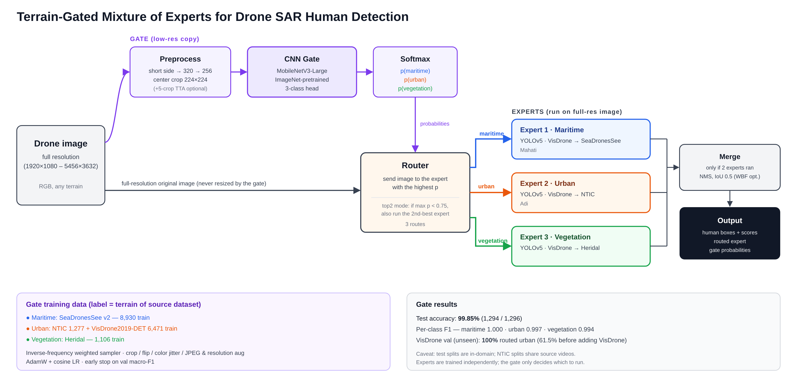

# Terrain-Gated Mixture of Experts for Drone SAR Human Detection

A small CNN gate looks at each drone image, decides its terrain (maritime, urban or vegetation), and sends the full-resolution image to the YOLOv5 expert trained for that terrain.



| Expert | Trained on | Weights |
|---|---|---|
| 1 · Maritime | VisDrone → SeaDronesSee | `weights/best_seabornsee.pt` |
| 2 · Urban | VisDrone → NTIC | `weights/nitc_expert_export/weights/best.pt` |
| 3 · Vegetation | VisDrone → Heridal | `weights/heridal_random_best.pt` |
| Gate | MobileNetV3-Large, 3 classes | `weights/gate_best.pt` |

## Results (gate test split)

| Method | Maritime | Urban | Vegetation | Macro mAP@0.5 |
|---|---|---|---|---|
| Best single expert | 0.451 | 0.010 | 0.930 | 0.464 |
| All 3 experts + NMS | 0.688 | 0.990 | 0.906 | 0.862 |
| **MoE (gate + router)** | **0.832** | **0.993** | **0.927** | **0.918** |

Gate routing accuracy: 99.8%. Full report with charts and annotated examples: [`runs/moe_eval/report.html`](runs/moe_eval/report.html) (download or clone, then open it in a browser).

## Setup

```bash
conda create -y -n moe python=3.12
conda activate moe
python -m pip install -r requirements.txt
```

Put the datasets in this folder under these names (paths are set in `config.yaml`):

```
seadronessee/                               # maritime (Hugging Face: dronefreak/SeaDronesSee)
NTIC_human_dataset_70_percent/              # urban
Heridal Human Detection.v1i.yolov5pytorch/  # vegetation (Roboflow export)
extra_urban/VisDrone2019-DET-train/         # extra urban images, gate training only
```

## Run

The trained gate and expert weights are already in `weights/`. To run the MoE:

```bash
python eval_moe.py                         # full evaluation (~5 min on an M-series Mac)
open runs/moe_eval/report.html             # metrics, charts, annotated examples

python run_moe.py --source <image or folder> --save   # detect on any images -> runs/moe/
```

To retrain the gate:

```bash
python build_gate_cache.py                 # one-time 320px image cache (~3 min)
python train_gate.py                       # -> weights/gate_best.pt
python eval_gate.py --split test           # accuracy + confusion matrix -> runs/gate_eval/
```

`eval_moe.py` also writes `runs/moe_eval/results_table.md` and `results_table.tex`: per-test-set Precision / Recall / mAP@50 / mAP@50:95 plus a mean-over-domains row, in the same layout as the team table. To add the team's Baseline and Multi-domain models as rows, list their weights in `config.yaml`:

```yaml
experts:
  baselines:
    Baseline: weights/<baseline>.pt
    Multi-domain: weights/<multi_domain>.pt
```

Useful flags: `eval_moe.py --limit 10` (quick check), `--from-cache` (re-render the report), `--tta` (5-crop gate). `run_moe.py --mode top2` adds the second-best expert when the gate is unsure.

## Layout

```
moe/                 library code
  data.py            dataset discovery and splits
  cache.py           320px gate-image cache
  gate_data.py       gate dataset and augmentation
  gate_model.py      MobileNetV3 gate
  experts.py         YOLOv5 experts, router, box merging
  utils.py           config, device, seed
build_gate_cache.py  train_gate.py  eval_gate.py  ood_check.py  run_moe.py  eval_moe.py
tools/audit_datasets.py   one-off dataset audit -> docs/audit_report.md
config.yaml          all settings
weights/             gate + expert checkpoints (YOLOv5 code in weights/nitc_expert_export/yolov5)
```

## Notes

- Splits: SeaDronesSee has no public test labels, so its val set is split by frame ID (lower half val, upper half test). NTIC and Heridal use their official splits.
- NTIC splits share source videos, and the vegetation expert used its own random Heridal split, so urban and vegetation scores may be optimistic. Set `eval.test_sets` in `config.yaml` to evaluate on other held-out folders.
- Some SeaDronesSee labels are offset by a few pixels, which lowers maritime mAP even where detections are correct.
- `ood_check.py --source <folder> --expect urban` routes outside images to check the gate learned terrain, not dataset cues (VisDrone val: 100% urban).
